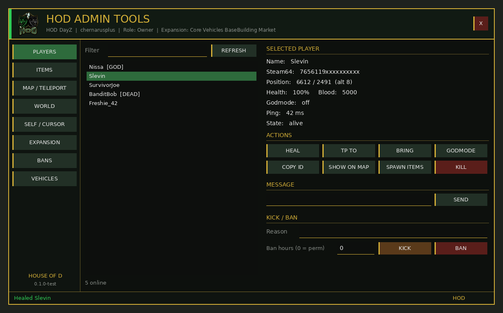

# HOD Admin Tools

House of D admin tools for DayZ. Written from scratch (no VPP or COT code), Expansion-aware.

Code: CC BY-SA 4.0. HOD branding: all rights reserved. See [NOTICE.md](NOTICE.md).

## Build (Linux, no DayZ Tools needed)
    ./build.sh
Output: `dist/@HOD_AdminTools/` and `dist/HOD_AdminTools_test.zip` (unsigned test build).

## Layout
| Path | What |
|---|---|
| `src/HOD_AdminTools/` | PBO root (prefix `HOD_AdminTools`) |
| `scripts/3_Game` | RPC transport, JSON configs, permissions, logger/Discord |
| `scripts/4_World` | Server handler (all permission checks), Expansion bridge, vehicle tracker |
| `scripts/5_Mission` | Mission hooks, client state, admin menu UI |
| `tools/` | `pbo.py` packer, `img2paa.py` (DXT5 PAA), `gen_layouts.py`, `check_scripts.py` |
| `branding/` | Source logo art |
| `docs/` | Server readme, example profile JSON, menu preview |

## Expansion
All Expansion calls sit behind Expansion's own defines (`EXPANSIONMODVEHICLE`, `EXPANSIONMODBASEBUILDING`, `EXPANSIONMODMARKET`, `EXPANSIONMODCORE`), so the same PBO runs with or without Expansion.

## Status
0.1.0-test - not yet compiled by the DayZ engine. Check `script.log` / `crash.log` on first boot.
